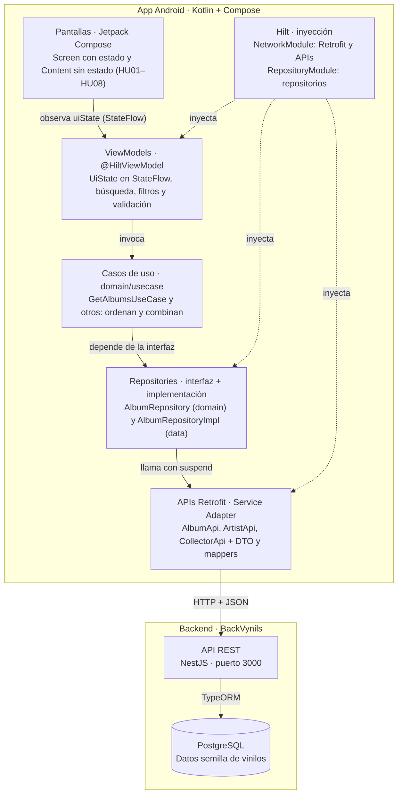
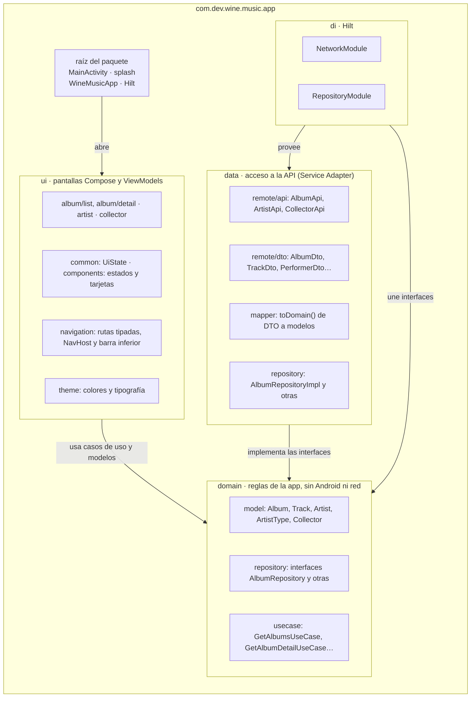
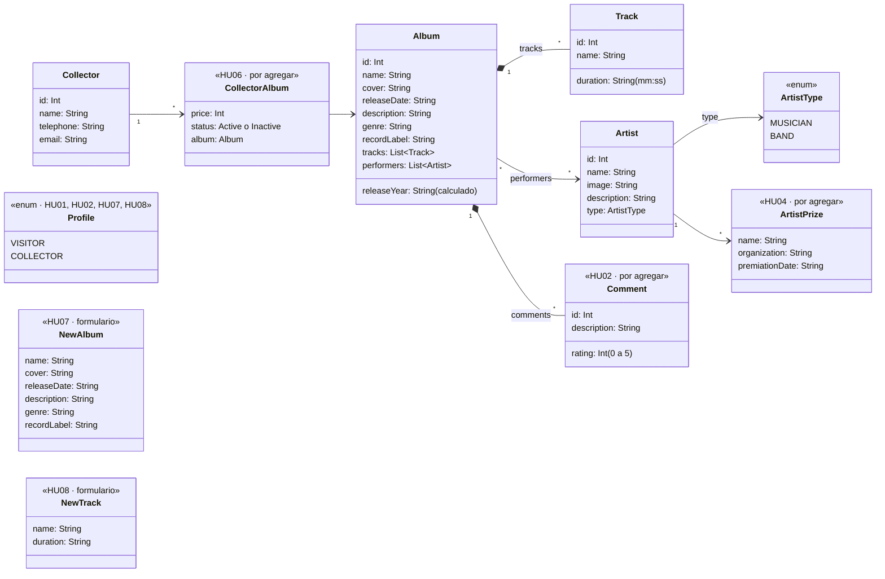
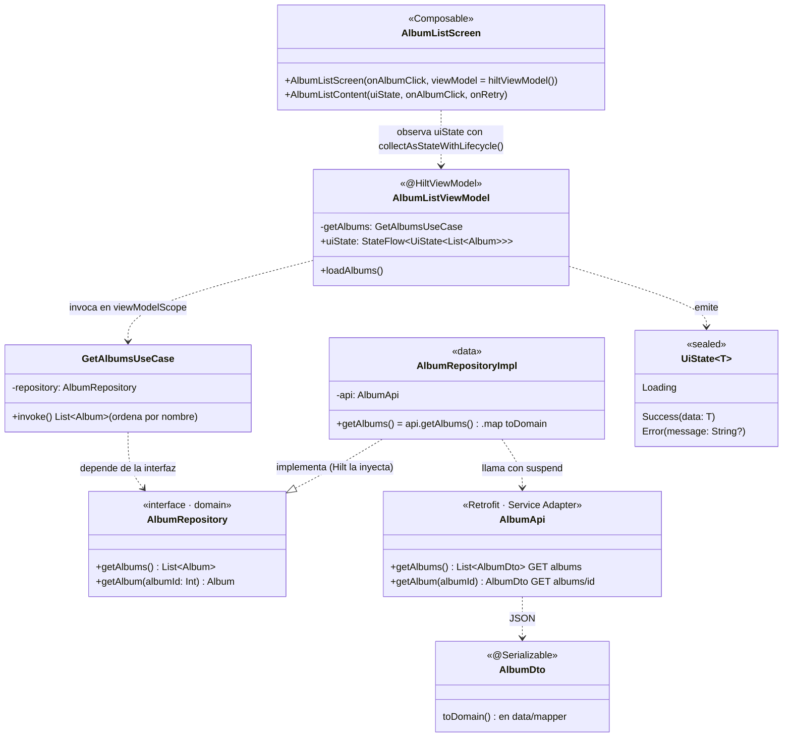

La app **Wine Music (Vinilos)** está construida en Kotlin con Jetpack Compose y arquitectura limpia: pantallas Compose con su ViewModel (MVVM), casos de uso en el dominio, un Repository por entidad y las interfaces de Retrofit como *Service Adapter* hacia la API REST de **BackVynils**.

**Decisiones técnicas ya tomadas en el código**

- Jetpack Compose con Material 3 y Navigation Compose con rutas tipadas.
- ViewModels con `StateFlow`.
- Casos de uso en `domain/usecase`.
- Retrofit con OkHttp y kotlinx.serialization para la red.
- Hilt para la inyección de dependencias.
- Coil para las imágenes.

**Cómo trabajar con el documento:** cada quien toma una HU de la sección [Reparto del trabajo](#reparto-del-trabajo), sigue su fila en el [mapa de trazabilidad](#mapa-de-trazabilidad) y usa la [checklist](#checklist-del-pull-request) antes de abrir el pull request. Los cambios de diseño se proponen en el pull request que modifica este archivo.

| Criterio de evaluación | Puntos | Dónde se responde |
|---|---|---|
| Diagramas de clases, paquetes y componentes | 5 | [Diagramas](#diagrama-de-componentes) |
| El diseño refleja las HU seleccionadas | 5 | [Mapa de trazabilidad](#mapa-de-trazabilidad) |
| El código es coherente con el diseño | 5 | [Coherencia código–diseño](#coherencia-códigodiseño) |
| Patrones MVVM, Repository y Service Adapter | 10 | [Patrones](#patrones-mvvm-repository-y-service-adapter) |
| Consumo de la API REST en las HU | 10 | [Consumo de la API REST](#consumo-de-la-api-rest) |
| README suficiente para construir localmente | 5 | [README](#readme) |

---

## Diagrama de componentes

Cada capa llama solo a la de abajo; las pantallas nunca tocan la red. Hilt arma la cadena: crea Retrofit y las APIs en `NetworkModule` y une cada interfaz de repositorio con su implementación en `RepositoryModule`.



## Diagrama de paquetes

`domain` no importa nada de Android, Retrofit ni Compose: `ui` y `data` dependen de él y no al revés. Solo `data` y `di` importan Retrofit, y ninguna pantalla importa `data`.




### Modelo de dominio

Hoy existen `Album`, `Track`, `Artist`, `ArtistType` y `Collector`; el resto llega con las HU pendientes (marcadas con la HU que las necesita).



### Cadena de Clases código

Cada clase conoce solo a la siguiente. Las demás HU repiten esta misma cadena con su propia pantalla, ViewModel, caso de uso, repositorio y API, como indica el mapa de trazabilidad.



---

## Mapa de trazabilidad

Cada HU recorre la misma cadena: pantalla Compose, ViewModel, caso de uso, repositorio y API de Retrofit. Hoy cuatro HU tienen la cadena empezada (HU01, HU02, HU03 y HU05); las otras cuatro están por construir. Los nombres de lo que falta siguen las convenciones del código.

| HU | Pantalla | ViewModel | Caso de uso | Repository · API | Endpoint |
|---|---|---|---|---|---|
| HU01 Catálogo | `AlbumListScreen` | `AlbumListViewModel` | `GetAlbumsUseCase` | `AlbumRepository.getAlbums()` · `AlbumApi.getAlbums()` | `GET /albums` |
| HU02 Detalle de álbum | `AlbumDetailScreen` | `AlbumDetailViewModel` | `GetAlbumDetailUseCase` | `AlbumRepository.getAlbum(id)` · `AlbumApi.getAlbum(id)` | `GET /albums/{id}` |
| HU03 Artistas | `ArtistListScreen` | `ArtistListViewModel` | `GetArtistsUseCase` | `ArtistRepository.getArtists()` · `ArtistApi.getMusicians()`, `getBands()` | `GET /musicians`, `GET /bands` |
| HU04 Detalle de artista | `ArtistDetailScreen` | `ArtistDetailViewModel` | `GetArtistDetailUseCase` | `ArtistRepository.getArtist(id, type)` · `ArtistApi.getMusician(id)`, `getBand(id)`, `getPerformerPrizes()` | `GET /musicians/{id}`, `GET /bands/{id}`, `GET /performerprizes` |
| HU05 Coleccionistas | `CollectorListScreen` | `CollectorListViewModel` | `GetCollectorsUseCase` | `CollectorRepository.getCollectors()` · `CollectorApi.getCollectors()` | `GET /collectors` |
| HU06 Detalle de coleccionista | `CollectorDetailScreen` | `CollectorDetailViewModel` | `GetCollectorDetailUseCase` | `CollectorRepository.getCollector(id)`, `getCollectorAlbums(id)` · `CollectorApi` | `GET /collectors/{id}`, `GET /collectors/{id}/albums` |
| HU07 Crear álbum | `AlbumCreateScreen` | `AlbumCreateViewModel` | `CreateAlbumUseCase` | `AlbumRepository.createAlbum(newAlbum)` · `AlbumApi.createAlbum(body)` | `POST /albums` |
| HU08 Asociar tracks | `AddTrackSheet` | `AddTrackViewModel` | `AddTrackUseCase` | `AlbumRepository.addTrack(albumId, newTrack)` · `AlbumApi.addTrack(id, body)` | `POST /albums/{id}/tracks` |

**Navegación:** las rutas tipadas viven en `ui/navigation/Routes.kt`. Hoy existen `AlbumsRoute`, `ArtistsRoute`, `CollectorsRoute` y `AlbumDetailRoute(albumId)`. Faltan `ArtistDetailRoute(artistId, type)`, `CollectorDetailRoute(collectorId)`, `AlbumCreateRoute` y la hoja de HU08 dentro del detalle. El botón «Crear álbum» de HU01 y «Agregar track» de HU02 solo aparecen con perfil coleccionista.

---

## Patrones: MVVM, Repository y Service Adapter

Los tres patrones de la rúbrica ya están en el código, con una capa más: los casos de uso del dominio. Cada capa solo conoce a la siguiente, y Hilt entrega cada dependencia por constructor.

| Capa | Paquete | Responsabilidad | Lo que no debe hacer |
|---|---|---|---|
| Pantalla (Compose) | `ui/<entidad>` | `Screen` obtiene el ViewModel y observa el estado; `Content` solo pinta y recibe eventos | Llamar casos de uso, repositorios o APIs |
| ViewModel (MVVM) | `ui/<entidad>` | Exponer `StateFlow<UiState<T>>`, filtrar, buscar y validar formularios | Conocer Retrofit, DTO o URLs |
| Caso de uso | `domain/usecase` | Una acción de negocio: ordenar, combinar o crear | Conocer Android o la red |
| Repository | interfaz en `domain/repository`, implementación en `data/repository` | Única fuente de datos de una entidad; convierte DTO en modelos | Conocer pantallas o ViewModels |
| Service Adapter | `data/remote/api` + `di/NetworkModule` | Interfaces de Retrofit, una función `suspend` por endpoint | Guardar estado de pantalla |

### Service Adapter: Retrofit

Cada recurso tiene su interfaz; `NetworkModule` crea un solo Retrofit con la URL base de `BuildConfig.API_BASE_URL`.

```kotlin
interface AlbumApi {
    @GET("albums")
    suspend fun getAlbums(): List<AlbumDto>

    @GET("albums/{id}")
    suspend fun getAlbum(@Path("id") albumId: Int): AlbumDto

    // Por agregar en HU07 y HU08
    @POST("albums")
    suspend fun createAlbum(@Body body: AlbumRequestDto): AlbumDto

    @POST("albums/{id}/tracks")
    suspend fun addTrack(@Path("id") albumId: Int, @Body body: TrackRequestDto): TrackDto
}
```

### Repository

`RepositoryModule` une la interfaz con su implementación con `@Binds`, así las pruebas pueden usar repositorios falsos (`app/src/test/.../fakes/FakeRepositories.kt`).

```kotlin
// domain/repository
interface AlbumRepository {
    suspend fun getAlbums(): List<Album>
    suspend fun getAlbum(albumId: Int): Album
}

// data/repository
class AlbumRepositoryImpl @Inject constructor(
    private val api: AlbumApi,
) : AlbumRepository {
    override suspend fun getAlbums(): List<Album> = api.getAlbums().map { it.toDomain() }
    override suspend fun getAlbum(albumId: Int): Album = api.getAlbum(albumId).toDomain()
}
```

### Caso de uso y ViewModel

```kotlin
class GetAlbumsUseCase @Inject constructor(private val repository: AlbumRepository) {
    suspend operator fun invoke(): List<Album> =
        repository.getAlbums().sortedBy { it.name.lowercase() }
}

@HiltViewModel
class AlbumListViewModel @Inject constructor(
    private val getAlbums: GetAlbumsUseCase,
) : ViewModel() {

    private val _uiState = MutableStateFlow<UiState<List<Album>>>(UiState.Loading)
    val uiState: StateFlow<UiState<List<Album>>> = _uiState.asStateFlow()

    init { loadAlbums() }

    fun loadAlbums() {
        viewModelScope.launch {
            _uiState.value = UiState.Loading
            _uiState.value = try {
                UiState.Success(getAlbums())
            } catch (e: CancellationException) {
                throw e
            } catch (e: Exception) {
                UiState.Error(e.message)
            }
        }
    }
}
```

### Pantalla

Cada pantalla tiene dos funciones: `AlbumListScreen` obtiene el ViewModel con `hiltViewModel()` y observa `uiState` con `collectAsStateWithLifecycle()`; `AlbumListContent` es una función sin estado que pinta carga, error, vacío o la lista. Esa separación permite probar la interfaz sin red, como hace `AlbumListContentTest`. Búsqueda y filtros de HU01, HU03 y HU05 van en el ViewModel, sobre la lista ya cargada.

---

## Consumo de la API REST

Las HU comprometidas usan 12 endpoints de BackVynils; el código ya consume 5 (`GET /albums`, `GET /albums/{id}`, `GET /musicians`, `GET /bands` y `GET /collectors`). Todas las llamadas salen de las interfaces de Retrofit en `data/remote/api`, con la URL base `BuildConfig.API_BASE_URL` (`http://10.0.2.2:3000/`, definida en `app/build.gradle.kts`). La referencia completa del backend está en `Backend-technical-documentation.md` del repositorio BackVynils.

| Método y ruta | HU | Función de Retrofit | En el código |
|---|---|---|---|
| `GET /albums` | HU01 | `AlbumApi.getAlbums()` | Existe |
| `GET /albums/{id}` | HU02 | `AlbumApi.getAlbum(id)` | Existe; `AlbumDto` aún no lee `comments` |
| `GET /musicians` | HU03 | `ArtistApi.getMusicians()` | Existe |
| `GET /bands` | HU03 | `ArtistApi.getBands()` | Existe; `PerformerDto` aún no lee `musicians` (de ahí sale la banda de cada músico) |
| `GET /musicians/{id}` | HU04 | `ArtistApi.getMusician(id)` | Por agregar |
| `GET /bands/{id}` | HU04 | `ArtistApi.getBand(id)` | Por agregar |
| `GET /performerprizes` | HU04 | `ArtistApi.getPerformerPrizes()` | Por agregar |
| `GET /collectors` | HU05 | `CollectorApi.getCollectors()` | Existe |
| `GET /collectors/{id}` | HU06 | `CollectorApi.getCollector(id)` | Por agregar |
| `GET /collectors/{id}/albums` | HU06 | `CollectorApi.getCollectorAlbums(id)` | Por agregar |
| `POST /albums` | HU07 | `AlbumApi.createAlbum(body)` | Por agregar |
| `POST /albums/{id}/tracks` | HU08 | `AlbumApi.addTrack(id, body)` | Por agregar |

### Cuerpos de los POST

**`POST /albums` (HU07).** El backend valida los valores de género y sello, y rechaza con `400` cualquier campo que no esté en su esquema (por ejemplo `id`).

```json
{
  "name": "Buscando América",
  "cover": "https://…/portada.jpg",
  "releaseDate": "1984-08-01T00:00:00-05:00",
  "description": "Primer álbum de Rubén Blades con Seis del Solar",
  "genre": "Salsa",
  "recordLabel": "Elektra"
}
```

| Campo | Valores válidos (texto exacto) |
|---|---|
| `genre` | `Classical`, `Salsa`, `Rock`, `Folk` (en pantalla se muestra «Clásica» y se envía `Classical`) |
| `recordLabel` | `Sony Music`, `EMI`, `Discos Fuentes`, `Elektra`, `Fania Records` |

**`POST /albums/{id}/tracks` (HU08):**

```json
{ "name": "Todos vuelven", "duration": "6:33" }
```

La respuesta del track trae el álbum embebido (`album`); `TrackDto` lo ignora gracias a `ignoreUnknownKeys = true`.

### Manejo de errores

Hoy cada ViewModel captura cualquier excepción y la guarda en `UiState.Error(message)`, y la pantalla muestra `ErrorView` con «Reintentar». Para cubrir el diseño hay que distinguir el tipo de error. La propuesta es agregar un campo `type` a `UiState.Error` y llenarlo según la excepción de Retrofit:

| Excepción | Significado | Qué muestra la app |
|---|---|---|
| `IOException` | Sin conexión o servidor caído | `ErrorView` con «Reintentar» (ya existe) |
| `HttpException` 404 | El recurso no existe | Pantalla «No encontrado» (por agregar) |
| `HttpException` 400 o 412 | Datos rechazados por el backend | Mensaje en el formulario, sin perder lo escrito (por agregar) |
| `HttpException` 500 | Error del servidor | `ErrorView` con «Reintentar» |

Los errores del backend llegan con el cuerpo `{ "statusCode": 404, "message": "The album with the given id was not found" }`; en un `400` de validación, `message` trae el texto de Joi.

### Detalles del backend a tener en cuenta

- Los POST responden `200`, no `201`: se trata cualquier 2xx como éxito.
- Los comentarios de un álbum llegan sin su autor. Para mostrar el nombre en HU02 se cruza el id del comentario con los `comments` de `GET /collectors`.
- Los premios de un artista (`performerPrizes`) llegan solo con id y fecha. El nombre y la organización del premio salen de `GET /performerprizes`, cruzando por id.
- `GET /musicians` y `GET /musicians/{id}` **no** devuelven la banda del músico. La banda se obtiene de `GET /bands`, cuyas bandas traen su arreglo `musicians`. Un músico tiene una sola banda; si no tiene, la app muestra «Sin banda».
- `GET /collectors` trae `collectorAlbums` solo con `id`, `price` y `status`; los datos del álbum salen de `GET /collectors/{id}/albums`.
- El precio de la colección (HU06) no trae moneda; se muestra el número tal cual.
- Las fechas llegan en ISO 8601 UTC (`"1984-08-01T05:00:00.000Z"`, medianoche en Colombia).
- Músicos y bandas comparten la tabla `performer`, así que sus ids no se repiten entre sí.
- El backend no tiene autenticación: el perfil visitante o coleccionista se resuelve solo en la app.
- Endpoints con errores conocidos en el backend (no usarlos sin revisar su sección 8): `POST /bands/{id}/albums/{albumId}` reemplaza todos los intérpretes del álbum, y los `DELETE` de asociaciones álbum ↔ banda/músico no eliminan nada.

---

## Coherencia código–diseño

El código es coherente con el diseño cuando los paquetes y clases coinciden con los diagramas y con el mapa de trazabilidad. El código base ya fija las convenciones; las HU nuevas las copian, y cualquier clase nueva se agrega también al diagrama de clases de este documento.

### Convenciones

- Paquete raíz `com.dev.wine.music.app`, con `ui`, `domain`, `data` y `di`.
- Por cada HU: `<Entidad><Acción>Screen` y `<Entidad><Acción>Content` en el mismo archivo, `<Entidad><Acción>ViewModel` con `@HiltViewModel`, y un caso de uso `<Verbo><Entidad>UseCase` con `operator fun invoke`.
- Repositorios: interfaz `<Entidad>Repository` en `domain`, `<Entidad>RepositoryImpl` en `data`, enlazados en `RepositoryModule`.
- Red: una interfaz `<Entidad>Api` por recurso, DTO con `@Serializable` en `remote/dto` y funciones `toDomain()` en `data/mapper`.
- Estado de pantalla: siempre `StateFlow<UiState<T>>`, con `LoadingView`, `ErrorView` y `EmptyView` de `ui/components`.
- Rutas nuevas como clases `@Serializable` en `Routes.kt`.
- Textos en `strings.xml`, en español como el diseño; colores y tipografía solo desde `ui/theme`.
- Una rama por HU desde `h0_base_architecture` (por ejemplo `hu04_detalle_artista`) y un pull request por HU.

### Checklist del pull request

- [ ] La HU usa la pantalla, el ViewModel, el caso de uso, el repositorio y la API de su fila en el mapa de trazabilidad.
- [ ] Ningún archivo de `ui` importa algo de `data`; ningún archivo de `domain` importa Android, Retrofit ni Compose.
- [ ] El ViewModel expone `StateFlow` y no conoce DTO ni URLs.
- [ ] La pantalla tiene su función `Content` sin estado y muestra carga, error y vacío.
- [ ] Las acciones de coleccionista solo aparecen con ese perfil.
- [ ] Hay pruebas del caso de uso y del ViewModel con los repositorios falsos de `fakes`.
- [ ] Si se agregó una clase, ya está en el diagrama de clases.
- [ ] La app compila y corre siguiendo solo el README.

---

## Reparto del trabajo

La arquitectura base ya está en la rama `h0_base_architecture`; falta integrarla a `main`. Lo pendiente son cuatro HU nuevas, completar cuatro parciales y tres piezas transversales (tema, perfil y errores) que varias HU necesitan. Cada quien escribe su nombre en Responsable y actualiza el Estado (Por hacer · En curso · En revisión · Hecho).

| # | Tarea | Depende de | Responsable | Estado |
|---|---|---|---|---|
| 1 | Arquitectura base: Compose, Hilt, Retrofit, navegación, `UiState` y vistas de estado (rama `h0_base_architecture`) | — | | En revisión |
| 2 | Tema del estilo A: colores, Fraunces e IBM Plex, textos en español | 1 | | Por hacer |
| 3 | Perfil visitante/coleccionista: `Profile`, `ProfileRepository` y pantalla de elegir perfil | 1 | | Por hacer |
| 4 | Errores por tipo: 404 con pantalla «No encontrado», 400/412 en formularios | 1 | | Por hacer |
| 5 | HU01 completar: búsqueda, filtro por género, intérprete en la tarjeta, botón «Crear álbum» | 2, 3 | | Por hacer |
| 6 | HU02 completar: reseñas (`comments` en el DTO), fecha completa, intérpretes navegables, «Agregar track» | 3, 4 | | Por hacer |
| 7 | HU03 completar: filtro por tipo, banda del músico, navegación al detalle | 2 | | Por hacer |
| 8 | HU04 Detalle de artista: API, caso de uso, ViewModel, pantalla y ruta | 4, 7 | | Por hacer |
| 9 | HU05 completar: búsqueda, iniciales, navegación al detalle | 2 | | Por hacer |
| 10 | HU06 Detalle de coleccionista: API, caso de uso, ViewModel, pantalla y ruta | 4, 9 | | Por hacer |
| 11 | HU07 Crear álbum: `POST /albums`, formulario con validación, pantalla de álbum creado | 4, 5 | | Por hacer |
| 12 | HU08 Asociar tracks: `POST /albums/{id}/tracks` y hoja de agregar track | 4, 6 | | Por hacer |
| 13 | Diagramas finales de clases, paquetes y componentes | 5 a 12 | | Por hacer |
| 14 | README con instrucciones de construcción (texto listo en la sección [README](#readme)) | 1 | | Por hacer |

La tarea 14 la valida alguien que no haya escrito el README: si logra construir la app solo con esas instrucciones, el criterio queda cubierto. Las tareas 13 y 14 piden poco esfuerzo y cubren 10 puntos de la rúbrica.
