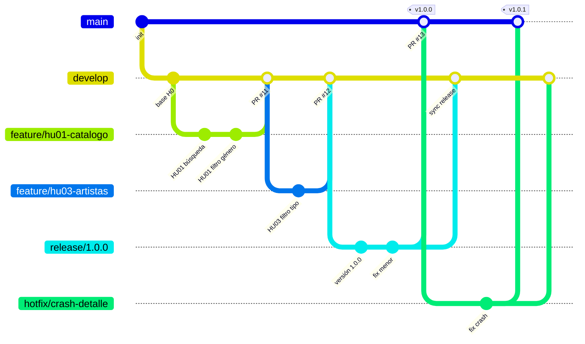
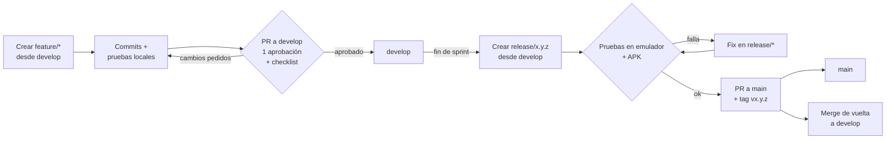

# Gitflow de trabajo – Vinilos

El trabajo avanza en una sola dirección: **rama de usuario → `develop` → `release` → `main`**. Cada paso es un pull request revisado por al menos otra persona del equipo; nadie hace push directo a `develop`, `release/*` ni `main`.

## Ramas

| Rama | Sale de | Se integra en | Para qué sirve | Vida |
|---|---|---|---|---|
| `main` | — | — | Código entregado y estable; cada merge lleva un tag de versión (`v1.0.0`) | Permanente |
| `develop` | `main` | `release/*` | Integración del trabajo terminado del sprint | Permanente |
| `release/<versión>` | `develop` | `main` (y de vuelta a `develop`) | Estabilizar una entrega: pruebas, correcciones menores, versión y APK | Hasta la entrega |
| `feature/<hu>-<descripción>` | `develop` | `develop` | Trabajo de una persona sobre una HU o tarea | Hasta su merge |
| `hotfix/<descripción>` | `main` | `main` y `develop` | Corregir un error urgente ya entregado | Hasta su merge |

## Flujo completo



## Proceso paso a paso



### 1. Trabajo de cada persona (rama de usuario → `develop`)

```bash
git checkout develop
git pull origin develop
git checkout -b feature/hu04-detalle-artista

# ... trabajo y commits ...
git push -u origin feature/hu04-detalle-artista
```

1. Abrir el pull request **hacia `develop`** (no hacia `main`).
2. Antes de pedir revisión, traer lo último de `develop` y resolver conflictos en la propia rama: `git pull origin develop`.
3. Pasar la [checklist del pull request](App-technical-documentation.md#checklist-del-pull-request) y confirmar que `./gradlew test` pasa.
4. Una aprobación de otra persona del equipo y merge con **squash**, para dejar un commit por HU en `develop`.
5. Borrar la rama después del merge.

### 2. Preparar una entrega (`develop` → `release`)

Al cerrar el sprint, con todas las HU de la entrega ya en `develop`:

```bash
git checkout develop
git pull origin develop
git checkout -b release/1.0.0
```

1. Subir `versionCode` y `versionName` en `app/build.gradle.kts`.
2. Probar en el emulador contra BackVynils y generar el APK (`./gradlew assembleDebug`).
3. En `release/*` solo entran correcciones de errores; nada de funcionalidades nuevas.

### 3. Entregar (`release` → `main`)

1. Abrir el pull request de `release/1.0.0` **hacia `main`** y hacer merge con **merge commit** (sin squash), para conservar el historial.
2. Crear el tag de la versión:

   ```bash
   git checkout main
   git pull origin main
   git tag -a v1.0.0 -m "Entrega 1: HU01–HU04"
   git push origin v1.0.0
   ```

3. Llevar las correcciones hechas en la release de vuelta a `develop` (PR de `release/1.0.0` → `develop`) y borrar la rama `release`.

### 4. Correcciones urgentes (`hotfix`)

Solo para errores ya entregados en `main`: rama `hotfix/<descripción>` desde `main`, PR a `main` con un tag de parche (`v1.0.1`) y luego PR a `develop`.

## Convenciones

**Nombres de rama:** minúsculas y guiones, con la HU al inicio cuando aplica.

| Tipo | Ejemplo |
|---|---|
| Funcionalidad de una HU | `feature/hu07-crear-album` |
| Tarea transversal | `feature/perfil-visitante`, `feature/errores-por-tipo` |
| Entrega | `release/1.0.0` |
| Corrección urgente | `hotfix/crash-detalle-album` |

**Mensajes de commit:** `tipo(ANDES): descripción en presente`, el formato que ya usa el repositorio.

| Tipo | Uso | Ejemplo |
|---|---|---|
| `feat` | Funcionalidad nueva | `feat(ANDES): HU07 formulario de crear álbum` |
| `fix` | Corrección de error | `fix(ANDES): reintentar carga en detalle de álbum` |
| `test` | Pruebas | `test(ANDES): AlbumCreateViewModel valida campos vacíos` |
| `docs` | Documentación | `docs(ANDES): diagrama de clases HU04` |
| `refactor` | Cambio interno sin cambiar comportamiento | `refactor(ANDES): UiState.Error con tipo de error` |
| `chore` | Build, dependencias, versión | `chore(ANDES): versión 1.0.0` |

**Versiones:** `MAYOR.MENOR.PARCHE`. `MENOR` sube en cada entrega de sprint, `PARCHE` en cada hotfix.

## Protección de ramas en GitHub

En *Settings → Branches* agregar reglas para `main`, `develop` y `release/*`:

- Exigir pull request con al menos 1 aprobación.
- Bloquear push directo y force push.
- Exigir que la rama esté actualizada antes del merge.
- (Opcional) exigir que pase un workflow de CI con `./gradlew test`.

## Puesta en marcha

Hoy existen `main` y `h0_base_architecture`. Para arrancar con este flujo:

```bash
# 1. Crear develop desde main
git checkout main
git pull origin main
git checkout -b develop
git push -u origin develop
```

2. Abrir un PR de `h0_base_architecture` → `develop` con la arquitectura base (tarea 1 del reparto).
3. Desde ese momento, cada HU sale de `develop` como `feature/huXX-...`.
