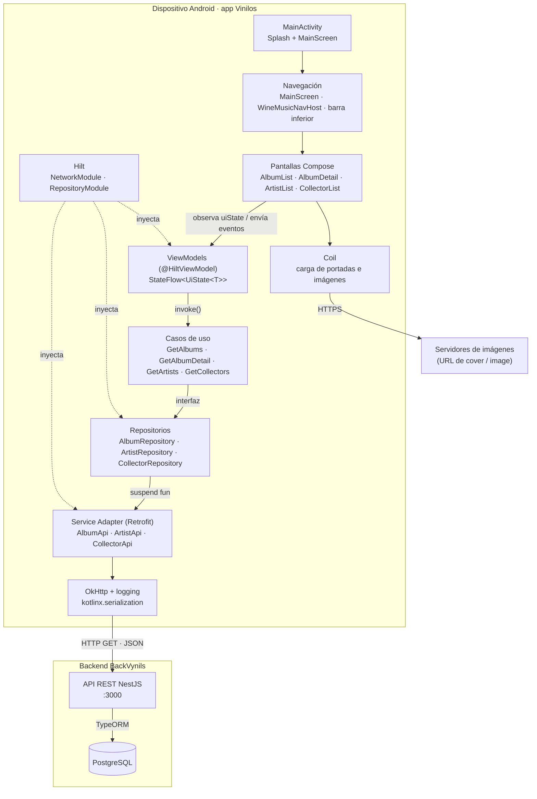
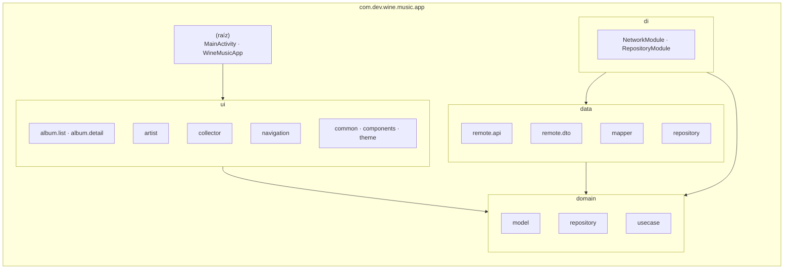
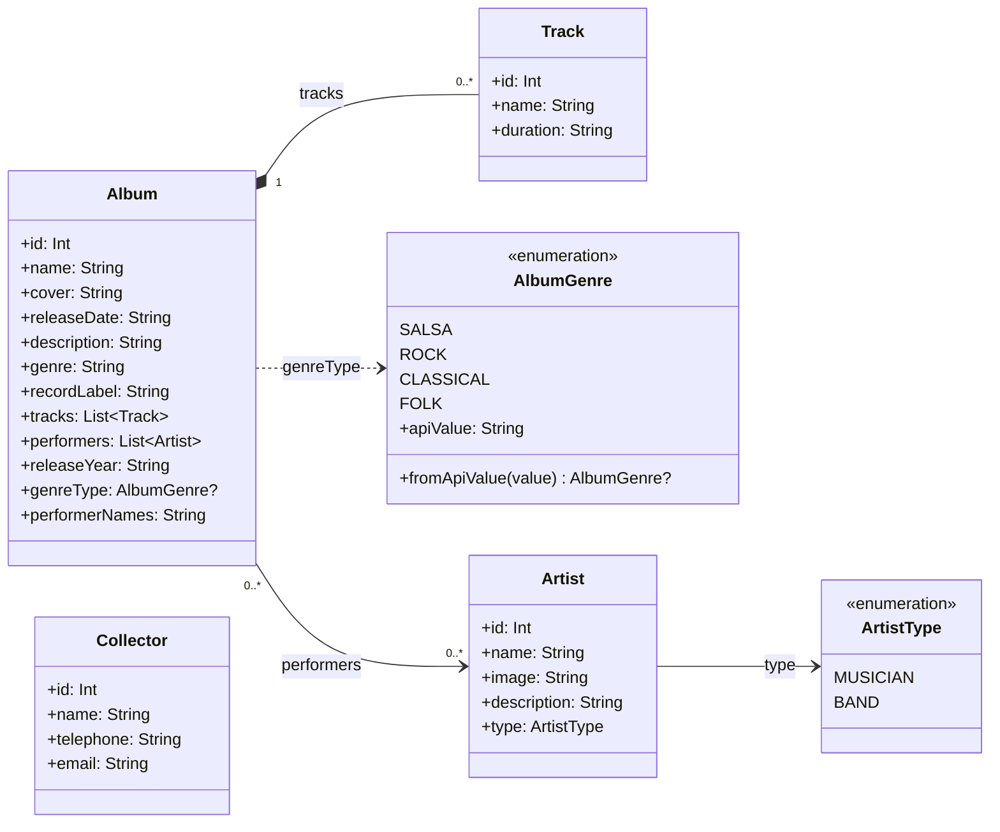
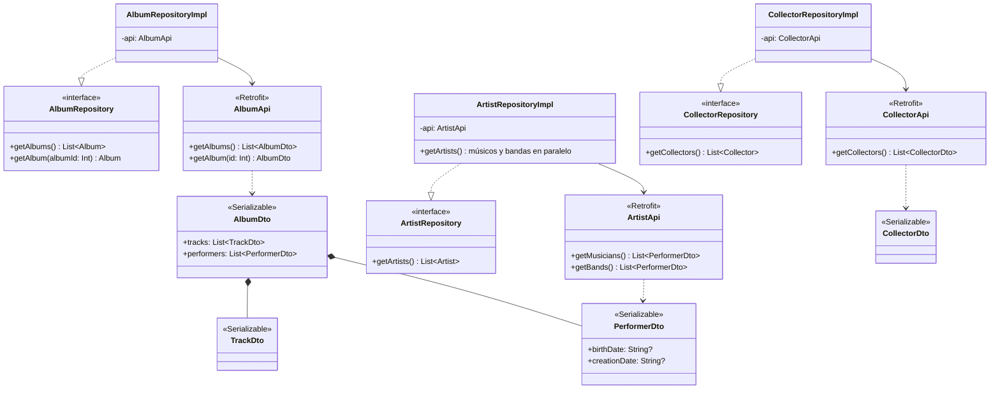
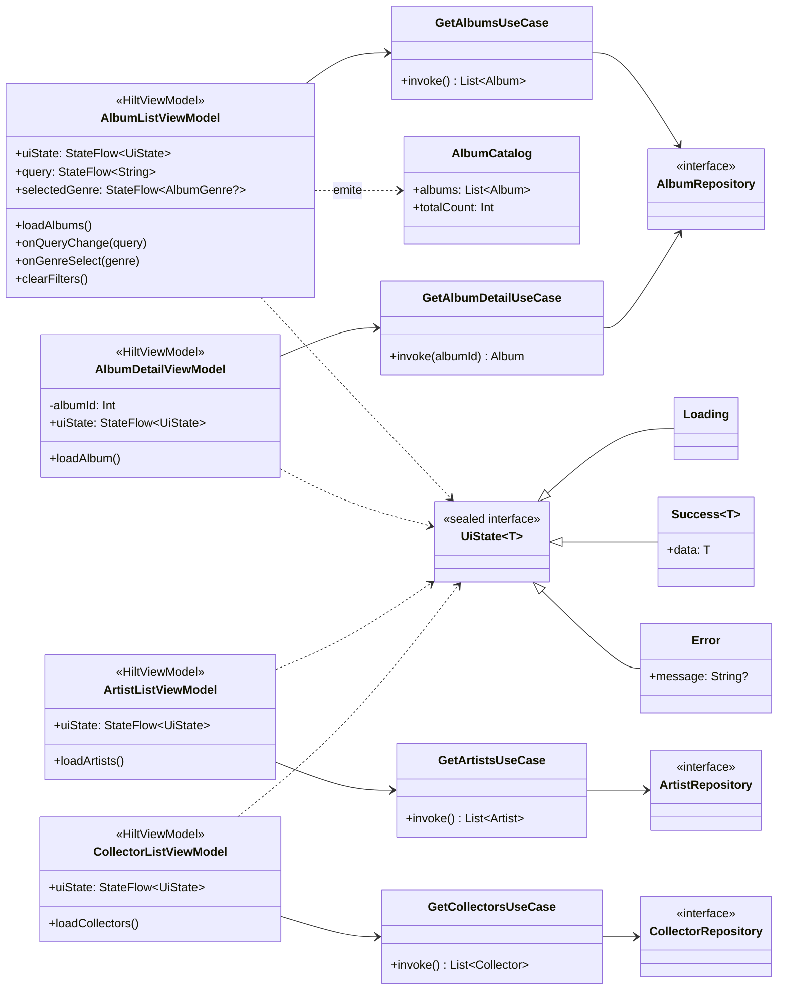
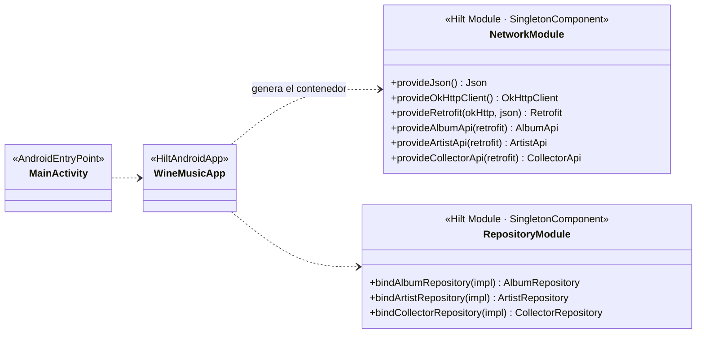
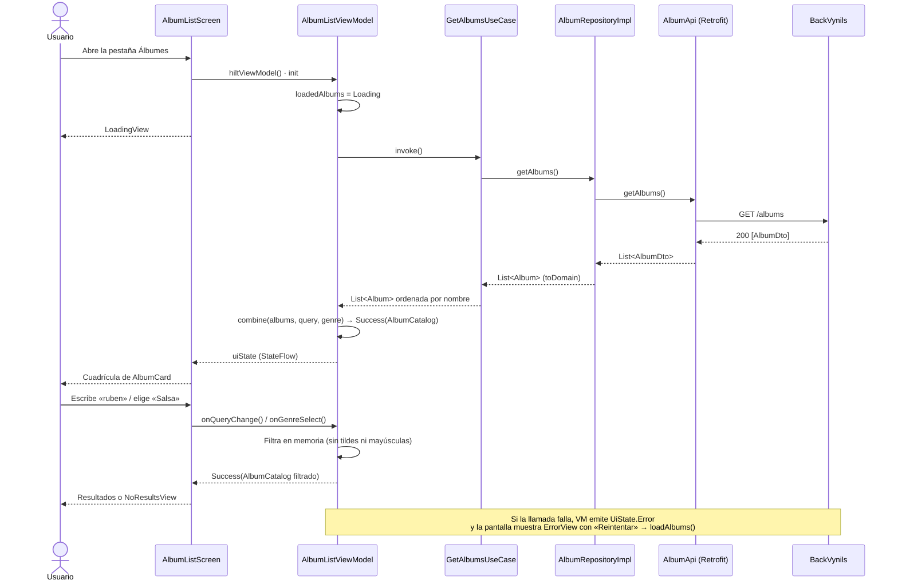
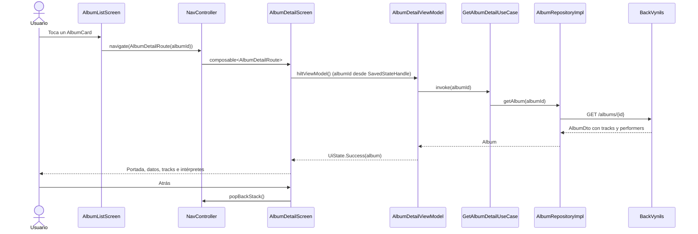
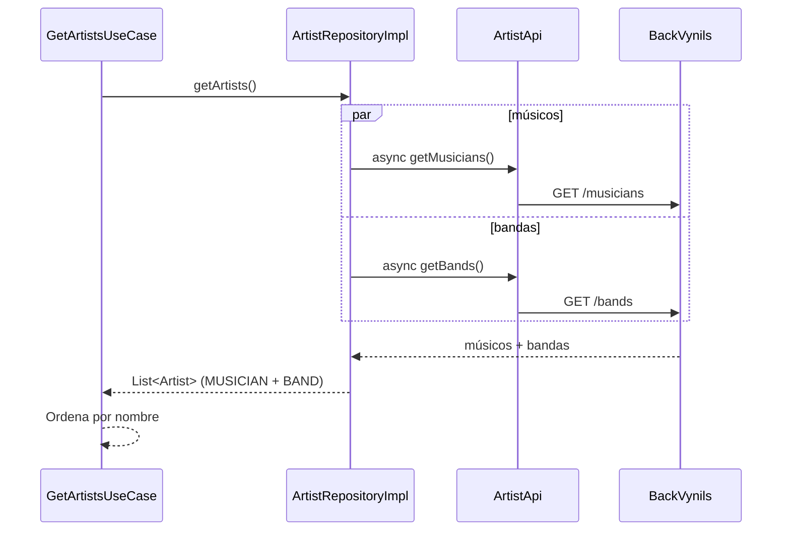
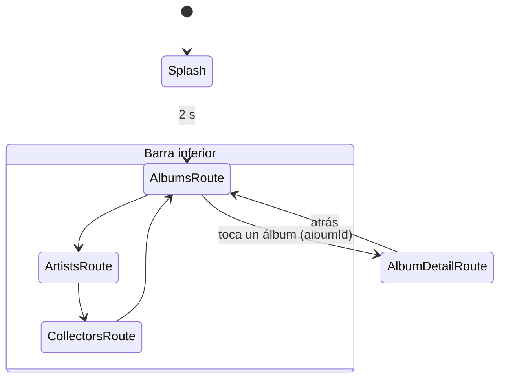

# Sprint 1 · Diseño arquitectónico

**Wine Music (Vinilos)** · Equipo 10 · MISW4104 Ingeniería de Software para Aplicaciones Móviles

Esta página describe la arquitectura de la app Android tal como está en el código de la rama `develop` al cierre del sprint 1. Incluye los diagramas de **componentes**, **paquetes** y **clases** que pide la rúbrica, más diagramas de secuencia y de navegación que muestran cómo se recorre la arquitectura en las HU implementadas.

> Documento de trabajo del equipo con el detalle de cada HU: [`docs/App-technical-documentation.md`](../App-technical-documentation.md) en el repositorio.

## Contenido

1. [Visión general](#1-visión-general)
2. [Decisiones de arquitectura](#2-decisiones-de-arquitectura)
3. [Diagrama de componentes](#3-diagrama-de-componentes)
4. [Diagrama de paquetes](#4-diagrama-de-paquetes)
5. [Diagramas de clases](#5-diagramas-de-clases)
6. [Diagramas de secuencia](#6-diagramas-de-secuencia)
7. [Navegación](#7-navegación)
8. [Patrones MVVM, Repository y Service Adapter](#8-patrones-mvvm-repository-y-service-adapter)
9. [Trazabilidad HU → código → API](#9-trazabilidad-hu--código--api)
10. [Estado, errores y concurrencia](#10-estado-errores-y-concurrencia)
11. [Tecnologías](#11-tecnologías)
12. [Riesgos y evolución](#12-riesgos-y-evolución)

---

## 1. Visión general

Vinilos es una app nativa Android escrita en **Kotlin** con **Jetpack Compose**. Consume la API REST **BackVynils** (NestJS + PostgreSQL) para mostrar álbumes, artistas y coleccionistas.

La arquitectura sigue **MVVM** sobre **Clean Architecture** en tres capas, más un módulo de inyección de dependencias:

| Capa | Paquete | Qué contiene | De qué depende |
|---|---|---|---|
| Presentación | `ui` | Pantallas Compose (`Screen` + `Content`), ViewModels, navegación, tema y componentes reutilizables | `domain` |
| Dominio | `domain` | Modelos, interfaces de repositorio y casos de uso. Kotlin puro: sin Android, Retrofit ni Compose | Nada |
| Datos | `data` | Interfaces Retrofit (Service Adapter), DTO, mappers e implementaciones de repositorio | `domain` |
| Inyección | `di` | Módulos de Hilt que crean Retrofit y conectan cada interfaz con su implementación | `data`, `domain` |

**Regla de dependencias:** las flechas siempre apuntan hacia `domain`. Ninguna pantalla importa `data` y ningún archivo de `domain` importa librerías de Android o de red. Así se puede cambiar la fuente de datos (por ejemplo, agregar caché en el sprint 2) sin tocar las pantallas, y probar ViewModels y casos de uso con repositorios falsos.

## 2. Decisiones de arquitectura

| # | Decisión | Alternativa descartada | Motivo |
|---|---|---|---|
| D1 | Jetpack Compose + Material 3 | Vistas XML + Fragments | Interfaz declarativa, menos código y pruebas de UI sin emulador de vistas (`ComposeTestRule`). |
| D2 | MVVM con `StateFlow<UiState<T>>` | LiveData | `StateFlow` es parte de corrutinas, funciona en pruebas unitarias sin Android y se observa con `collectAsStateWithLifecycle()`, que respeta el ciclo de vida. |
| D3 | Capa de casos de uso en `domain/usecase` | ViewModel llamando directo al repositorio | Las reglas (ordenar por nombre, combinar fuentes) quedan en un solo lugar y se prueban aisladas. |
| D4 | Repository con interfaz en `domain` e implementación en `data` | Repositorio concreto | Permite inyectar repositorios falsos en las pruebas y agregar caché local sin cambiar a quien lo usa. |
| D5 | Retrofit + kotlinx.serialization como Service Adapter | Volley | Interfaces declarativas con funciones `suspend`, sin callbacks; un único cliente HTTP para toda la app. |
| D6 | Hilt para inyección de dependencias | Singletons manuales / Service Locator | Un único `Retrofit` y una única instancia de cada repositorio (`@Singleton`), y ViewModels creados con sus dependencias (`@HiltViewModel`). |
| D7 | Navigation Compose con rutas tipadas (`@Serializable`) | Rutas como texto | El compilador valida los argumentos (`AlbumDetailRoute(albumId)`). |
| D8 | Búsqueda y filtros en memoria, en el ViewModel | Llamar a la API por cada búsqueda | El backend no ofrece búsqueda; filtrar la lista ya cargada evita llamadas de red mientras se escribe. |
| D9 | Coil para imágenes | Glide / Picasso | Pensado para Compose y corrutinas, con caché de memoria y disco. |

## 3. Diagrama de componentes

Cada componente llama solo al de abajo. Hilt construye la cadena al iniciar la app.

| Componente | Interfaz que ofrece | Consume |
|---|---|---|
| Pantallas Compose | Lo que ve el usuario | `uiState` del ViewModel |
| ViewModels | `uiState: StateFlow<UiState<T>>` y funciones de evento (`loadAlbums()`, `onQueryChange()`…) | Casos de uso |
| Casos de uso | `operator fun invoke()` | Interfaces de repositorio |
| Repositorios | `getAlbums()`, `getAlbum(id)`, `getArtists()`, `getCollectors()` | Interfaces Retrofit |
| Service Adapter | Una función `suspend` por endpoint | API REST de BackVynils |

## 4. Diagrama de paquetes

Paquete raíz: `com.dev.wine.music.app`.

| Paquete | Clases | Responsabilidad |
|---|---|---|
| *(raíz)* | `WineMusicApp`, `MainActivity` | Arranque de Hilt (`@HiltAndroidApp`), splash y contenido Compose |
| `ui.album.list` | `AlbumListScreen`, `AlbumListContent`, `AlbumListViewModel`, `AlbumCatalog` | HU01: catálogo con búsqueda y filtro por género |
| `ui.album.detail` | `AlbumDetailScreen`, `AlbumDetailContent`, `AlbumDetailViewModel` | HU02: detalle de álbum |
| `ui.artist` | `ArtistListScreen`, `ArtistListContent`, `ArtistListViewModel` | HU03: listado de artistas |
| `ui.collector` | `CollectorListScreen`, `CollectorListContent`, `CollectorListViewModel` | HU05: listado de coleccionistas |
| `ui.navigation` | `MainScreen`, `WineMusicNavHost`, `Routes`, `TopLevelDestination` | Barra inferior, grafo y rutas tipadas |
| `ui.common` | `UiState` | Estados Loading / Success / Error |
| `ui.components` | `AlbumCard`, `LoadingView`, `ErrorView`, `EmptyView`, `NoResultsView`, `AlbumGenre.labelRes()` | Componentes reutilizables |
| `ui.theme` | `WineMusicAppTheme`, colores, tipografía | Sistema de diseño |
| `domain.model` | `Album`, `Track`, `AlbumGenre`, `Artist`, `ArtistType`, `Collector` | Entidades del negocio |
| `domain.repository` | `AlbumRepository`, `ArtistRepository`, `CollectorRepository` | Contratos de acceso a datos |
| `domain.usecase` | `GetAlbumsUseCase`, `GetAlbumDetailUseCase`, `GetArtistsUseCase`, `GetCollectorsUseCase` | Acciones de negocio |
| `data.remote.api` | `AlbumApi`, `ArtistApi`, `CollectorApi` | Service Adapter (Retrofit) |
| `data.remote.dto` | `AlbumDto`, `TrackDto`, `PerformerDto`, `CollectorDto` | Forma del JSON del backend |
| `data.mapper` | `AlbumDto.toDomain()`, `PerformerDto.toDomain()`, `CollectorDto.toDomain()` | DTO → modelo de dominio |
| `data.repository` | `AlbumRepositoryImpl`, `ArtistRepositoryImpl`, `CollectorRepositoryImpl` | Implementación de los contratos |
| `di` | `NetworkModule`, `RepositoryModule` | Grafo de dependencias de Hilt |

## 5. Diagramas de clases

### 5.1 Modelo de dominio

### 5.2 Capa de datos (Service Adapter, DTO y repositorios)

Los mappers (`data/mapper`) son funciones de extensión `toDomain()`. `PerformerDto.toDomain(type)` recibe el tipo cuando el endpoint lo indica (`/musicians` o `/bands`); dentro de un álbum lo deduce: si trae `creationDate` es banda, si no, músico.

### 5.3 Capa de presentación y dominio por HU

Las cuatro HU implementadas repiten la misma cadena **Screen → ViewModel → UseCase → Repository**.

Cada pantalla tiene dos funciones Compose en el mismo archivo:

- **`XxxScreen`**: obtiene el ViewModel con `hiltViewModel()` y observa `uiState` con `collectAsStateWithLifecycle()`.
- **`XxxContent`**: no tiene estado. Recibe el `UiState` y lambdas de eventos y pinta carga, error, vacío o datos. Se prueba sin red ni ViewModel (por ejemplo, `AlbumListContentTest`).

### 5.4 Inyección de dependencias

- `Json` usa `ignoreUnknownKeys = true` y `coerceInputValues = true`: campos nuevos o nulos del backend no rompen la app.
- `OkHttpClient` registra el cuerpo de las peticiones solo en *debug*.
- La URL base viene de `BuildConfig.API_BASE_URL` (por defecto `http://10.0.2.2:3000/`; se cambia con `api.base.url` en `local.properties`).

## 6. Diagramas de secuencia

### 6.1 HU01 · Consultar catálogo de álbumes (carga y búsqueda)

### 6.2 HU02 · Consultar detalle de álbum

### 6.3 HU03 · Listado de artistas (llamadas en paralelo)

## 7. Navegación

La app usa una sola `Activity` (`MainActivity`) y Navigation Compose. `MainScreen` dibuja la barra inferior solo en las pestañas principales.

| Ruta (`Routes.kt`) | Pantalla | HU | Argumentos |
|---|---|---|---|
| `AlbumsRoute` (inicio) | `AlbumListScreen` | HU01 | — |
| `AlbumDetailRoute` | `AlbumDetailScreen` | HU02 | `albumId: Int` |
| `ArtistsRoute` | `ArtistListScreen` | HU03 | — |
| `CollectorsRoute` | `CollectorListScreen` | HU05 | — |

Al cambiar de pestaña se usa `popUpTo(start) { saveState = true }`, `launchSingleTop` y `restoreState`: cada pestaña existe una sola vez en la pila y conserva su scroll.

## 8. Patrones MVVM, Repository y Service Adapter

| Patrón | Dónde está | Cómo se aplica |
|---|---|---|
| **MVVM** | `ui/**/XxxViewModel` + `XxxScreen` | El ViewModel guarda el estado en `StateFlow<UiState<T>>` y sobrevive a la rotación. La vista solo observa y envía eventos; nunca llama a casos de uso ni a la red. |
| **Repository** | Interfaz en `domain/repository`, implementación en `data/repository` | Es la única puerta a los datos de cada entidad. Convierte DTO en modelos y oculta de dónde vienen (hoy la red; en el sprint 2, también caché). |
| **Service Adapter** | `data/remote/api` + `di/NetworkModule` | Interfaces Retrofit con una función `suspend` por endpoint, sobre un único `Retrofit` *singleton*. Solo los repositorios las usan. |
| **Use Case** (adicional) | `domain/usecase` | Una acción de negocio por clase (`operator fun invoke`), por ejemplo, ordenar alfabéticamente. |
| **Inyección de dependencias** | `di` + `@Inject` | Hilt entrega cada dependencia por constructor, lo que permite reemplazarlas en las pruebas. |

## 9. Trazabilidad HU → código → API

| HU | Pantalla | ViewModel | Caso de uso | Repositorio → Service Adapter | Endpoint | Estado en sprint 1 |
|---|---|---|---|---|---|---|
| HU01 Catálogo de álbumes | `AlbumListScreen` | `AlbumListViewModel` | `GetAlbumsUseCase` | `AlbumRepository.getAlbums()` → `AlbumApi.getAlbums()` | `GET /albums` | Implementada, con búsqueda, filtro por género y pruebas unitarias, de UI y E2E |
| HU02 Detalle de álbum | `AlbumDetailScreen` | `AlbumDetailViewModel` | `GetAlbumDetailUseCase` | `AlbumRepository.getAlbum(id)` → `AlbumApi.getAlbum(id)` | `GET /albums/{id}` | Cadena completa; faltan reseñas |
| HU03 Listado de artistas | `ArtistListScreen` | `ArtistListViewModel` | `GetArtistsUseCase` | `ArtistRepository.getArtists()` → `ArtistApi.getMusicians()`, `getBands()` | `GET /musicians`, `GET /bands` | Cadena completa (listado básico) |
| HU05 Listado de coleccionistas | `CollectorListScreen` | `CollectorListViewModel` | `GetCollectorsUseCase` | `CollectorRepository.getCollectors()` → `CollectorApi.getCollectors()` | `GET /collectors` | Cadena completa (listado básico) |
| HU04, HU06, HU07, HU08 | — | — | — | — | Ver [documento técnico](../App-technical-documentation.md#mapa-de-trazabilidad) | Planeadas para los sprints 2 y 3 |

## 10. Estado, errores y concurrencia

**Estado de pantalla.** Toda pantalla que carga datos usa `UiState<T>`:

| Estado | Qué se muestra |
|---|---|
| `Loading` | `LoadingView` (indicador de progreso) |
| `Success(data)` con datos | El contenido |
| `Success(data)` vacío | `EmptyView`, o `NoResultsView` si hay filtros activos |
| `Error(message)` | `ErrorView` con botón «Reintentar» |

**Errores.** El ViewModel captura cualquier excepción de la cadena y emite `UiState.Error`. `CancellationException` se vuelve a lanzar para no romper la cancelación estructurada de corrutinas.

**Concurrencia.**
- Las llamadas de red son funciones `suspend` que se lanzan en `viewModelScope`; Retrofit las ejecuta fuera del hilo principal, así que no bloquean la interfaz (prevención de ANR).
- `ArtistRepositoryImpl` pide músicos y bandas en paralelo con `async` dentro de `coroutineScope`.
- `AlbumListViewModel` combina la lista, la búsqueda y el género con `combine` + `stateIn(WhileSubscribed(5_000))`: el flujo se detiene 5 s después de que la pantalla deja de observarlo y sobrevive a la rotación.

## 11. Tecnologías

| Área | Librería | Versión |
|---|---|---|
| Lenguaje | Kotlin | 2.0.0 |
| Build | Android Gradle Plugin · KSP | 8.8.0 · 2.0.0-1.0.24 |
| SDK | `compileSdk` / `targetSdk` · `minSdk` | 35 · 24 |
| UI | Jetpack Compose (BOM) + Material 3 | 2024.09.03 |
| Navegación | Navigation Compose | 2.8.4 |
| Ciclo de vida | Lifecycle ViewModel / Runtime Compose | 2.8.7 |
| Inyección | Hilt · Hilt Navigation Compose | 2.52 · 1.2.0 |
| Red | Retrofit · OkHttp logging | 2.11.0 · 4.12.0 |
| JSON | kotlinx.serialization | 1.7.3 |
| Imágenes | Coil Compose | 2.7.0 |
| Pruebas | JUnit 4, kotlinx-coroutines-test, Compose UI Test, Espresso, Kraken | — |
| Backend | BackVynils (NestJS + TypeORM + PostgreSQL) | — |

## 12. Riesgos y evolución

**Riesgos abiertos**

| Riesgo | Impacto | Acción |
|---|---|---|
| `minSdk = 24`, pero el curso exige funcionar desde Android L (API 21) | La app no se instala en dispositivos con API 21–23 | Evaluar bajar `minSdk` a 21 y verificar que las librerías lo soporten |
| Sin caché local | Cada visita a una pantalla vuelve a llamar a la API | Agregar caché en los repositorios en el sprint 2 (el patrón Repository ya lo permite sin tocar la UI) |
| Los errores no se distinguen por tipo | Un 404 o un 400 se muestra igual que «sin conexión» | Agregar el tipo de error a `UiState.Error` (`IOException`, `HttpException` 404, 400/412) |
| Particularidades del backend (comentarios sin autor, banda del músico solo en `/bands`, POST que responden 200) | Datos incompletos en HU02, HU04 y HU06 | Cruzar datos en los repositorios, como se documenta en el documento técnico |

**Evolución prevista**

- **Sprint 2:** HU04 (detalle de artista) y HU06 (detalle de coleccionista) con nuevas rutas `ArtistDetailRoute` y `CollectorDetailRoute`; caché en repositorios; micro-optimizaciones y profiling.
- **Sprint 3:** HU07 (crear álbum, `POST /albums`) y HU08 (asociar tracks, `POST /albums/{id}/tracks`), con perfil visitante/coleccionista y validación de formularios.

Cada HU nueva sigue la misma cadena de clases y debe agregarse a los diagramas de esta página.
