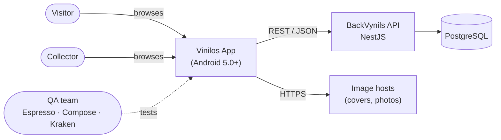

# Sprint 1 · Estrategia de pruebas

**Wine Music (Vinilos)** · Equipo 10 · MISW4104 Ingeniería de Software para Aplicaciones Móviles

Esta estrategia sigue la plantilla del curso de *Pruebas automatizadas* de MISO: **aplicación bajo pruebas → contexto → objetivos por funcionalidad → presupuesto → TNT (Técnicas, Niveles y Tipos) → distribución de esfuerzo**. Al final se agregan los criterios de entrada/salida, la gestión de datos de prueba y el manejo de defectos.

> Inventario y resultados de la ejecución: [Sprint 1 · Resultados de pruebas](Sprint-1-Resultados-de-pruebas). Arquitectura: [Sprint 1 · Diseño arquitectónico](Sprint-1-Diseno-arquitectonico).

## Contenido

1. [Aplicación bajo pruebas](#1-aplicación-bajo-pruebas)
2. [Contexto de la estrategia](#2-contexto-de-la-estrategia)
3. [Objetivos de la estrategia](#3-objetivos-de-la-estrategia)
4. [Duración de la iteración](#4-duración-de-la-iteración)
5. [Presupuesto de pruebas](#5-presupuesto-de-pruebas)
6. [TNT: técnicas, niveles y tipos de prueba](#6-tnt-técnicas-niveles-y-tipos-de-prueba)
7. [Distribución de esfuerzo](#7-distribución-de-esfuerzo)
8. [Criterios de entrada y salida](#8-criterios-de-entrada-y-salida)
9. [Gestión de datos de prueba](#9-gestión-de-datos-de-prueba)
10. [Reporte de defectos](#10-reporte-de-defectos)

---

## 1. Aplicación bajo pruebas

### 1.1 Nombre
Vinilos – *Wine Music* (paquete `com.dev.wine.music.app`).

### 1.2 Versión
`1.0` (versionCode 1), release del sprint 1. `minSdk 21` (Android 5.0 Lollipop), `targetSdk 35`.

### 1.3 Descripción
App nativa Android en Kotlin + Jetpack Compose para que **visitantes** y **coleccionistas** consulten un catálogo de álbumes de vinilo, sus artistas y los coleccionistas que los poseen. Consume la API REST **BackVynils** (NestJS + PostgreSQL). Arquitectura MVVM + Repository + Service Adapter (Retrofit) con inyección de dependencias Hilt.

### 1.4 Funcionalidades core (alcance del sprint 1)

| HU | Funcionalidad | Pantalla | Endpoint |
|---|---|---|---|
| HU01 | Consultar catálogo de álbumes (búsqueda por nombre/intérprete, filtro por género) | `AlbumListScreen` | `GET /albums` |
| HU02 | Consultar el detalle de un álbum (datos, tracks, intérpretes, comentarios) | `AlbumDetailScreen` | `GET /albums/{id}`, `GET /collectors` |
| HU03 | Consultar el listado de artistas (músicos y bandas, filtro por tipo) | `ArtistListScreen` | `GET /musicians`, `GET /bands` |
| HU05 | Consultar el listado de coleccionistas | `CollectorListScreen` | `GET /collectors` |

Fuera de alcance en este sprint (se agregan en S2–S3 como regresión): HU04, HU06, HU07, HU08.

### 1.5 Diagrama de arquitectura
Ver el [diagrama de componentes UML](Sprint-1-Diseno-arquitectonico#3-diagrama-de-componentes-uml). Las pruebas se ubican por capa: unitarias en `domain` y `data` (con *fakes*), de ViewModel en `ui` (con `MainDispatcherRule`), de contenido Compose sin red y E2E sobre `MainActivity`.

### 1.6 Diagrama de contexto

### 1.7 Modelo de datos
Entidades de dominio que se verifican: `Album` (name, cover, releaseDate, description, genre, recordLabel, tracks, performers, comments), `Track`, `Comment`, `Artist` (`MUSICIAN` | `BAND`), `Collector`. Valores enumerados que validan las pruebas: `genre ∈ {Classical, Salsa, Rock, Folk}`. Diagrama: [modelo de dominio](Sprint-1-Diseno-arquitectonico#51-modelo-de-dominio).

### 1.8 Modelo de GUI
Navegación por barra inferior (Álbumes · Artistas · Coleccionistas) y detalle de álbum. Cada pantalla tiene los estados **cargando, éxito, vacío, sin resultados y error (red / no encontrado / servidor) con reintento**. Wireframes: carpeta *Vinilos – Wireframes* (HU01–HU08). Los elementos se localizan en las pruebas por `testTag` (p. ej. `album_list`, `album_search_input`, `album_genre_tab_salsa`, `album_detail`, `artist_list`, `nav_artists`, `back_button`).

## 2. Contexto de la estrategia

### 2.1 Pruebas y versiones previas
Es la primera versión de la app: no hay pruebas previas ni defectos heredados. En el inception solo se validaron los wireframes con el equipo.

### 2.2 Objetivo de negocio
Entregar a The Software Design Company (TSDC) una versión estable de las HU de consulta que funcione **desde Android 5.0 (API 21)**, con datos reales de BackVynils y manejo correcto de errores de red, para que el cliente pueda revisarla y aprobar el avance hacia las HU de escritura.

## 3. Objetivos de la estrategia

Un objetivo por funcionalidad/pantalla. Cada objetivo tiene su fila en la tabla TNT (sección 6), que indica cómo se prueba.

| ID | Funcionalidad / pantalla | Objetivo de prueba |
|---|---|---|
| **OBJ-1** | HU01 · Catálogo de álbumes | Verificar que el catálogo muestra los álbumes del backend con portada, nombre e intérprete, que la búsqueda (sin tildes ni mayúsculas) y el filtro por género devuelven solo álbumes que cumplen ambos criterios, que “sin resultados” se puede limpiar y que tocar un álbum abre su detalle. |
| **OBJ-2** | HU02 · Detalle de álbum | Verificar que el detalle muestra sello, fecha de lanzamiento, descripción, tracks con duración, intérpretes y comentarios con su autor, que un álbum inexistente muestra “no encontrado” sin reintento y que *atrás* regresa al catálogo. |
| **OBJ-3** | HU03 · Listado de artistas | Verificar que se listan músicos y bandas juntos (dos llamadas en paralelo), que el filtro por tipo muestra solo el tipo elegido y que “Todos” los recupera. |
| **OBJ-4** | HU05 · Listado de coleccionistas | Verificar que se listan los coleccionistas con nombre, teléfono y correo, y que la lista vacía y los errores se muestran correctamente. |
| **OBJ-5** | Transversal · Manejo de errores y estados | Verificar en todas las pantallas los estados de carga, vacío, error de red, error de servidor (5xx) y no encontrado (404), y que *Reintentar* vuelve a cargar los datos. |
| **OBJ-6** | Transversal · Compatibilidad | Verificar que la app instala, abre y recorre las HU sin fallos en Android 5.0 (API 21), una versión media (API 29–30) y la más reciente (API 35). |
| **OBJ-7** | Transversal · Lógica y datos | Verificar que mappers, repositorios, casos de uso y ViewModels transforman, ordenan y filtran los datos correctamente sin depender de red ni de Android. |

## 4. Duración de la iteración

Sprint 1 = **2 semanas** (semanas 3 y 4 del curso). Las pruebas corren en paralelo al desarrollo: cada HU se cierra solo cuando sus pruebas están en verde (definición de terminado).

## 5. Presupuesto de pruebas

### 5.1 Recursos humanos

| Integrante | Rol en pruebas | Dedicación a pruebas |
|---|---|---|
| Jhon Edman Linares Rivera | Pruebas de HU01 (unitarias, ViewModel, Compose, E2E) | ~5 h/semana |
| Nicolas Zambrano Madero | Estrategia, inventario, reporte de resultados y Kraken | ~5 h/semana |
| Jesus Enrique Quesada Diaz | Pruebas de HU02 y escenarios de error con `FakeBackendRule` | ~5 h/semana |
| Juan Martin Santos Ayala | Pruebas de HU03 y HU05, compatibilidad en API 21 | ~5 h/semana |

Total: 4 personas × ~5 h × 2 semanas ≈ **40 horas‑persona**.

> Ajustar responsables y horas con lo que reporte cada integrante en la retrospectiva.

### 5.2 Recursos computacionales

| Recurso | Uso |
|---|---|
| 4 portátiles con Android Studio (Ladybug o superior), JDK 17 | Desarrollo y ejecución de `./gradlew test` y `connectedAndroidTest` |
| Emuladores AVD: API 21 (Android 5.0), API 30 (Android 11), API 35 (Android 15) | Compatibilidad (OBJ-6) y E2E |
| Al menos un teléfono físico Android | Kraken y pruebas exploratorias |
| BackVynils local (Docker) y desplegado (`https://backvynils-q6yc.onrender.com/`) | Backend real para E2E |
| Node 20 + Kraken + Appium | Escenarios Gherkin |

### 5.3 Recursos económicos
**USD 0.** Todas las herramientas son gratuitas o de código abierto (Android Studio, JUnit, Espresso/Compose Test, Kraken, Appium, Docker). El backend se despliega en el plan gratuito de Render. No se contrata personal ni servicios externos; Firebase Test Lab (plan Spark gratuito) queda como opción para el sprint 2.

## 6. TNT: técnicas, niveles y tipos de prueba

| Nivel | Tipo | Técnica | Objetivo | Herramienta · ubicación |
|---|---|---|---|---|
| Unidad | Funcional (caja blanca) | Pruebas unitarias con *fakes* de API y repositorio | OBJ-7, OBJ-1, OBJ-2, OBJ-3 | JUnit 4 + coroutines-test · `app/src/test` (`*MapperTest`, `*RepositoryImplTest`, `*UseCaseTest`, `SafeApiCallTest`) |
| Unidad | Funcional | Pruebas de ViewModel con `MainDispatcherRule` y repositorios falsos | OBJ-1, OBJ-2, OBJ-3, OBJ-5 | JUnit 4 · `AlbumListViewModelTest`, `AlbumDetailViewModelTest`, `ArtistListViewModelTest` |
| Integración | Funcional | Contenido Compose aislado: se le pasa cada `UiState` y se verifica lo que se pinta | OBJ-1, OBJ-2, OBJ-3, OBJ-5 | Compose UI Test · `app/src/androidTest/.../ui` (`*ContentTest`) |
| Sistema | Funcional (caja negra) | E2E automatizadas sobre `MainActivity` contra BackVynils real (escenarios Dado/Cuando/Entonces) | OBJ-1, OBJ-2, OBJ-3 | Espresso + Compose Test, `@HiltAndroidTest` · `e2e/HUxx*E2ETest` |
| Sistema | No funcional (robustez) | E2E con backend falso (`FakeBackendRule` + `@UninstallModules(ApiConfigModule::class)`): 500, sin red, 404, vacío | OBJ-5 | Espresso + Compose Test · `e2e/HUxx*ErrorE2ETest` |
| Sistema | Funcional (aceptación) | Un escenario Gherkin por HU con su recorrido principal | OBJ-1, OBJ-2, OBJ-3 | Kraken + Appium · `e2e/kraken/features/HUxx-*.feature` |
| Sistema | No funcional (compatibilidad) | Ejecución de la suite instrumentada e instalación del APK en API 21, 30 y 35 | OBJ-6 | Emuladores AVD, `adb install -r` |
| Sistema | Funcional / usabilidad | Pruebas exploratorias manuales por sesiones de 30 min (sin red con `adb shell svc wifi disable`, rotación, *atrás*) | OBJ-4, OBJ-5, OBJ-6 | Teléfono físico + ADB |
| Unidad | Estático | Análisis estático y lint | OBJ-7 | `./gradlew lint` |

**Pirámide resultante:** muchas pruebas unitarias (rápidas, sin Android) → pruebas de contenido Compose → pocas E2E críticas por HU → un escenario Kraken por HU.

## 7. Distribución de esfuerzo

Horas‑persona planeadas por semana y técnica (40 h en total):

| Actividad / técnica | Semana 3 | Semana 4 | Total | % |
|---|---:|---:|---:|---:|
| Diseño de la estrategia, objetivos y casos (Dado/Cuando/Entonces) | 4 | 1 | 5 | 12,5 % |
| Unitarias (mappers, repositorios, casos de uso, ViewModels) | 7 | 3 | 10 | 25 % |
| Contenido Compose (`*ContentTest`) | 3 | 3 | 6 | 15 % |
| E2E Espresso/Compose con backend real y con backend falso | 3 | 6 | 9 | 22,5 % |
| Kraken (un escenario por HU) | 1 | 3 | 4 | 10 % |
| Compatibilidad API 21/30/35 + exploratorias | 0 | 3 | 3 | 7,5 % |
| Reporte de resultados, defectos como issues y wiki | 2 | 1 | 3 | 7,5 % |
| **Total** | **20** | **20** | **40** | **100 %** |

Por funcionalidad: HU01 35 %, HU02 25 %, HU03 20 %, HU05 10 %, transversales (errores y compatibilidad) 10 %.

## 8. Criterios de entrada y salida

| Criterio | Detalle |
|---|---|
| Entrada | HU con criterios de aceptación aprobados; pantalla con `testTag` en los elementos verificables; BackVynils con datos semilla; APK debug compilado. |
| Salida de una HU | 100 % de sus pruebas automatizadas en verde; escenario Kraken en verde; sin defectos críticos abiertos. |
| Salida del sprint (release) | `./gradlew test` y `connectedAndroidTest` en verde en API 21 y API 35; APK en `distributions/`; resultados publicados en la wiki; defectos abiertos registrados como issues. |

## 9. Gestión de datos de prueba

- **Solo lectura:** todas las HU del sprint 1 leen datos; las pruebas usan los datos semilla de BackVynils (“Buscando América”, “Rubén Blades Bellido de Luna”, “Queen”).
- **Aserciones robustas:** se verifica que un elemento exista (no conteos, orden ni “el primero”), y los filtros se comprueban con “todos los ítems mostrados cumplen”, para que las pruebas sigan en verde aunque el backend tenga más datos.
- **Escenarios de error:** usan `FakeBackendRule` con respuestas deterministas (`FakeBackendData`), sin depender del backend real.
- **Antes de la corrida oficial:** dejar BackVynils en datos semilla con `docker-compose down -v` (el backend tiene `dropSchema: false`).
- Detalle: [`docs/E2E-testing-guide.md`](../E2E-testing-guide.md) → “Datos de prueba y estado del backend”.

## 10. Reporte de defectos

Cada fallo encontrado se registra como **issue** con etiqueta `bug` y la HU, e incluye: pasos para reproducir, resultado esperado y obtenido, dispositivo/API, severidad (crítica, alta, media, baja) y evidencia (captura o log). El issue se enlaza en el inventario de [resultados](Sprint-1-Resultados-de-pruebas).
